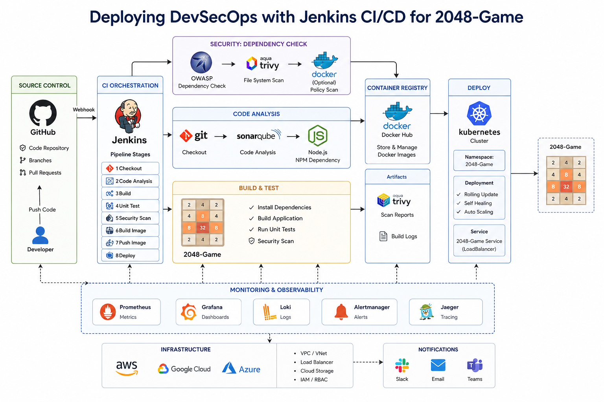

# 🎮 DevSecOps Pipeline: Deploying the 2048 Game on Docker & Kubernetes (EKS) with Jenkins CI/CD

An end-to-end **DevSecOps project**. Terraform creates the AWS EKS cluster, a Jenkins pipeline runs code-quality and security scans, builds and pushes a Docker image, and finally deploys the **2048 game** to Kubernetes.

## 🏗️ Architecture



> The diagram shows the full target design (including optional monitoring and notifications). The steps below cover what is implemented in this project: **GitHub → Jenkins → SonarQube → Trivy → Docker Hub → EKS**.

## 🧰 Tech Stack

| Category | Tools |
|---|---|
| Cloud | AWS EC2, EKS, S3, IAM |
| IaC | Terraform (S3 remote backend) |
| CI/CD | Jenkins |
| Code Quality | SonarQube (quality gate via webhook) |
| Security | Trivy (filesystem + image scan), OWASP Dependency-Check |
| Containers | Docker, Docker Hub |
| Orchestration | Kubernetes (EKS), kubectl |
| App | Node.js (2048 game) |

## 🔄 Overall Flow

```
Developer → GitHub → Jenkins → SonarQube → npm install → Trivy FS scan
        → Docker build & push (Docker Hub) → Trivy image scan
        → Deploy container → Deploy to EKS (kubectl apply) → LoadBalancer URL
```

## 📁 Repository Structure

```
devsecops-pipeline-2048-kubernetes/
├── EKS_TERRAFORM/        # Terraform code for the EKS cluster (backend.tf, main.tf ...)
├── Dockerfile            # Docker image of the 2048 game
├── deployment.yaml       # Kubernetes Deployment + Service (LoadBalancer)
├── package.json          # Node.js dependencies
├── 2048-Project.png      # Architecture diagram
└── README.md
```

## 📥 Clone the Repository

```bash
git clone https://github.com/vikasjagtap9696/devsecops-pipeline-2048-kubernetes.git
cd devsecops-pipeline-2048-kubernetes
```

---

# 🚀 Complete Working Process

## Step 1: Launch the AWS EC2 instance

1. Create an EC2 instance with **Ubuntu 24.04 AMI**, a large instance type (for example `t2.large` or `m7i-flex.large`) and **50 GB** storage.
2. Open the security group ports: **22** (SSH), **8080** (Jenkins), **9000** (SonarQube), **3000** (app container).
3. Attach an **IAM role** so the instance can create EKS and related resources (Admin access is only for learning. Use least privilege in real projects).
4. SSH into the instance.

## Step 2: Install the required tools

### Script 1: Java, Jenkins, Docker (`script1.sh`)

```bash
vi script1.sh
```

```bash
#!/bin/bash
set -e

# Update system and install Java 21
sudo apt update -y
sudo apt install -y openjdk-21-jdk wget curl
java -version

# Jenkins WAR setup
sudo mkdir -p /opt/jenkins
cd /opt/jenkins
if [ ! -f jenkins.war ]; then
  wget https://get.jenkins.io/war/2.552/jenkins.war
fi
sudo chmod 755 jenkins.war

# Run Jenkins in background
nohup java -Djava.net.preferIPv4Stack=true -jar /opt/jenkins/jenkins.war \
> /opt/jenkins/jenkins.log 2>&1 &

# Install Docker
sudo apt-get update
sudo apt-get install ca-certificates curl gnupg -y
sudo install -m 0755 -d /etc/apt/keyrings
curl -fsSL https://download.docker.com/linux/ubuntu/gpg | sudo gpg --dearmor -o /etc/apt/keyrings/docker.gpg
sudo chmod a+r /etc/apt/keyrings/docker.gpg
echo \
  "deb [arch=$(dpkg --print-architecture) signed-by=/etc/apt/keyrings/docker.gpg] https://download.docker.com/linux/ubuntu \
  $(. /etc/os-release && echo "$VERSION_CODENAME") stable" | \
  sudo tee /etc/apt/sources.list.d/docker.list > /dev/null
sudo apt-get update
sudo apt-get install docker-ce docker-ce-cli containerd.io docker-buildx-plugin docker-compose-plugin -y
sudo usermod -aG docker ubuntu
newgrp docker
```

```bash
chmod +x script1.sh && ./script1.sh
```

Open Jenkins at `http://<EC2-PUBLIC-IP>:8080` and finish the setup wizard.

### Script 2: Terraform, kubectl, AWS CLI (`script2.sh`)

```bash
#!/bin/bash
# Terraform
sudo apt install wget -y
wget -O- https://apt.releases.hashicorp.com/gpg | sudo gpg --dearmor -o /usr/share/keyrings/hashicorp-archive-keyring.gpg
echo "deb [signed-by=/usr/share/keyrings/hashicorp-archive-keyring.gpg] https://apt.releases.hashicorp.com $(lsb_release -cs) main" | sudo tee /etc/apt/sources.list.d/hashicorp.list
sudo apt update && sudo apt install terraform

# kubectl
sudo apt install curl -y
curl -LO https://dl.k8s.io/release/$(curl -L -s https://dl.k8s.io/release/stable.txt)/bin/linux/amd64/kubectl
sudo install -o root -g root -m 0755 kubectl /usr/local/bin/kubectl
kubectl version --client

# AWS CLI
curl "https://awscli.amazonaws.com/awscli-exe-linux-x86_64.zip" -o "awscliv2.zip"
sudo apt-get install unzip -y
unzip awscliv2.zip
sudo ./aws/install
```

### Script 3: Trivy (`trivy.sh`)

```bash
sudo apt update && sudo apt upgrade -y
sudo apt install -y wget apt-transport-https gnupg lsb-release
wget -qO - https://aquasecurity.github.io/trivy-repo/deb/public.key | sudo tee /etc/apt/trusted.gpg.d/trivy.asc
echo "deb https://aquasecurity.github.io/trivy-repo/deb $(lsb_release -cs) main" | sudo tee /etc/apt/sources.list.d/trivy.list
sudo apt update && sudo apt install -y trivy
trivy --version
sudo apt install -y libatomic1
```

### Run the SonarQube container

```bash
sudo usermod -aG docker jenkins      # preferred over chmod 777 on docker.sock
sudo systemctl daemon-reload
sudo systemctl restart docker.service

docker run -d --name sonar -p 9000:9000 sonarqube:lts-community
```

Open `http://<EC2-PUBLIC-IP>:9000`, log in with `admin` / `admin` and change the password when asked.

---

## Step 3: Jenkins Job 1 – EKS Provisioning (Terraform)

1. **Create an S3 bucket** (private) for the Terraform state, for example `devsecops-2048-vikas`.
2. Update the bucket name in `EKS_TERRAFORM/backend.tf`.
3. Install the **Terraform** plugin in Jenkins and restart.
4. Find the Terraform path on the server:
   ```bash
   which terraform
   ```
5. **Manage Jenkins → Tools → Terraform**: Name = `terraform`, uncheck *Install automatically*, Install directory = `/usr/bin/`.
6. **New Item → Pipeline → `EKSJOB`**. Tick **This project is parameterized** → Choice Parameter:
   - Name: `action`
   - Choices: `apply`, `destroy`
7. Paste this pipeline:

```groovy
pipeline {
    agent any
    stages {
        stage('Checkout from Git') {
            steps {
                git branch: 'main', url: 'https://github.com/vikasjagtap9696/devsecops-pipeline-2048-kubernetes.git'
            }
        }
        stage('Terraform version') {
            steps { sh 'terraform --version' }
        }
        stage('Terraform init') {
            steps { dir('EKS_TERRAFORM') { sh 'terraform init' } }
        }
        stage('Terraform validate') {
            steps { dir('EKS_TERRAFORM') { sh 'terraform validate' } }
        }
        stage('Terraform plan') {
            steps { dir('EKS_TERRAFORM') { sh 'terraform plan' } }
        }
        stage('Terraform apply/destroy') {
            steps { dir('EKS_TERRAFORM') { sh 'terraform ${action} --auto-approve' } }
        }
    }
}
```

8. **Build with Parameters → `apply`** to create the EKS cluster.

---

## Step 4: Install Jenkins plugins and tools (for the 2048 job)

**Manage Jenkins → Plugins → Available plugins**, install:

- Eclipse Temurin installer
- SonarQube Scanner
- NodeJS
- OWASP Dependency-Check
- Docker, Docker Commons, Docker Pipeline, Docker API, Docker-build-step

**Manage Jenkins → Tools**:

| Tool | Name | Configuration |
|---|---|---|
| JDK | `jdk25` | Install from adoptium.net (JDK 25+36) |
| SonarQube Scanner | `sonar-scanner` | Install automatically (latest) |
| NodeJS | `node25` | Install from nodejs.org (25.9.0) |
| Dependency-Check | `DP-Check` | Install from GitHub (latest) |
| Docker | `docker` | Install from docker.com (latest) |

## Step 5: Connect SonarQube with Jenkins

1. In SonarQube: **Administration → Security → Users → Tokens** → generate a token (name it `game`). Copy it once.
2. In Jenkins: **Manage Jenkins → Credentials → Global → Add Credentials**
   - Kind: Secret text, Scope: Global
   - Secret: *(your SonarQube token)*
   - ID: `sonar-token`
3. **Manage Jenkins → System → SonarQube servers**
   - Name: `sonar-server`
   - Server URL: `http://<EC2-PUBLIC-IP>:9000`
   - Authentication token: `sonar-token`
4. Add the quality-gate webhook in SonarQube: **Administration → Configuration → Webhooks → Create**
   - Name: `Jenkins`
   - URL: `http://<EC2-PUBLIC-IP>:8080/sonarqube-webhook/`
   - Secret: empty

## Step 6: Add Docker Hub credentials

**Manage Jenkins → Credentials → Global → Add Credentials**

- Kind: Username with password
- Username: `vikasjagtap9696`
- Password: *(your Docker Hub password or access token)*
- ID: `docker`

> If you restart Docker, the SonarQube container stops. Start it again with `docker ps -a` and `docker start sonar`.

## Step 7: Configure kubeconfig for EKS

On the Jenkins server:

```bash
aws eks update-kubeconfig --name EKS_CLUSTER --region ap-south-1
cat ~/.kube/config
kubectl get nodes
```

1. Copy the full content of `~/.kube/config` and save it on your local machine as `secret.txt`.
2. Install the Jenkins plugins: **Kubernetes, Kubernetes CLI, Kubernetes Client API, Kubernetes Credentials**.
3. **Manage Jenkins → Credentials → Global → Add Credentials**
   - Kind: Secret file
   - File: `secret.txt`
   - ID: `k8s`

## Step 8: Create the 2048 application pipeline (CI/CD)

**New Item → Pipeline → `2048`**, then paste:

```groovy
pipeline {
    agent any
    tools {
        jdk 'jdk25'
        nodejs 'node25'
    }
    environment {
        SCANNER_HOME = tool 'sonar-scanner'
    }
    stages {
        stage('clean workspace') {
            steps { cleanWs() }
        }
        stage('Checkout from Git') {
            steps {
                git branch: 'main', url: 'https://github.com/vikasjagtap9696/devsecops-pipeline-2048-kubernetes.git'
            }
        }
        stage('Sonarqube Analysis') {
            steps {
                withSonarQubeEnv('sonar-server') {
                    sh ''' $SCANNER_HOME/bin/sonar-scanner -Dsonar.projectName=Game \
                    -Dsonar.projectKey=Game '''
                }
            }
        }
        stage('quality gate') {
            steps {
                script {
                    waitForQualityGate abortPipeline: false, credentialsId: 'sonar-token'
                }
            }
        }
        stage('Install Dependencies') {
            steps { sh 'npm install' }
        }
        stage('TRIVY FS SCAN') {
            steps { sh 'trivy fs . > trivyfs.txt' }
        }
        stage('Docker Build & Push') {
            steps {
                script {
                    withDockerRegistry(credentialsId: 'docker', toolName: 'docker') {
                        sh 'docker build -t 2048 .'
                        sh 'docker tag 2048 vikasjagtap9696/2048:latest'
                        sh 'docker push vikasjagtap9696/2048:latest'
                    }
                }
            }
        }
        stage('TRIVY IMAGE SCAN') {
            steps { sh 'trivy image vikasjagtap9696/2048:latest > trivy.txt' }
        }
        stage('Deploy to container') {
            steps { sh 'docker run -d --name 2048 -p 3000:3000 vikasjagtap9696/2048:latest' }
        }
        stage('Deploy to kubernetes') {
            steps {
                script {
                    withKubeConfig(caCertificate: '', clusterName: '', contextName: '', credentialsId: 'k8s', namespace: '', restrictKubeConfigAccess: false, serverUrl: '') {
                        sh 'kubectl apply -f deployment.yaml'
                    }
                }
            }
        }
    }
}
```

Click **Build Now**.

> Make sure the `image:` line in `deployment.yaml` is `vikasjagtap9696/2048:latest`.

### What each stage does

| # | Stage | Purpose |
|---|---|---|
| 1 | Clean workspace | Start from a clean state |
| 2 | Checkout | Pull the code from GitHub |
| 3 | SonarQube analysis | Static code analysis |
| 4 | Quality gate | Wait for the SonarQube result via webhook |
| 5 | Install dependencies | `npm install` |
| 6 | Trivy FS scan | Scan project files for vulnerabilities |
| 7 | Docker build & push | Build the image and push to Docker Hub |
| 8 | Trivy image scan | Scan the Docker image |
| 9 | Deploy to container | Run the game in Docker on port 3000 |
| 10 | Deploy to Kubernetes | `kubectl apply` to EKS |

## Step 9: Verify the deployment

```bash
kubectl get nodes
kubectl get pods
kubectl get service
```

- **Docker container:** `http://<EC2-PUBLIC-IP>:3000`
- **Kubernetes:** open the `EXTERNAL-IP` / LoadBalancer URL from `kubectl get service` in the browser.

---

## 🛠️ Troubleshooting

| Problem | Fix |
|---|---|
| LoadBalancer not opening | In the EKS security group, add an inbound **All traffic** rule from the default SG |
| EKS job fails because IAM roles already exist | Delete `eks-cluster-cloud` and `eks-node-group-cloud` roles, then re-run |
| Container name `2048` already in use | `docker ps -a`, then `docker stop <id>` and `docker rm <id>` |
| SonarQube stopped after Docker restart | `docker start sonar` |
| Docker API version error | Run `systemctl edit docker.service`, add `[Service]` / `Environment=DOCKER_MIN_API_VERSION=1.24`, then `systemctl restart docker` and `docker start sonar` |
| Recreating EKS on the same machine | `aws eks list-clusters --region ap-south-1`, then `aws eks update-kubeconfig --region ap-south-1 --name <cluster-name>`, then `kubectl get all` |

## 🧹 Cleanup (avoid AWS charges)

1. Run `EKSJOB` with `action = destroy`.
2. Delete the S3 bucket, if no longer needed.
3. Stop or terminate the EC2 instance.

## 🔐 Security Notes

- Never commit tokens, passwords or public IPs to GitHub.
- Avoid `chmod 777 /var/run/docker.sock`. Add the Jenkins user to the `docker` group instead.
- Use least-privilege IAM roles instead of Admin access in real environments.

## 🚧 Future Improvements

- Prometheus + Grafana monitoring, Loki logs, Alertmanager and Jaeger tracing (shown in the architecture diagram)
- Slack / Email / Teams notifications from Jenkins
- Unit-test stage and OWASP Dependency-Check stage in the pipeline
- GitHub webhook to trigger builds automatically on push

## 👤 Author

**Vikas Jagtap**
- GitHub: [@vikasjagtap9696](https://github.com/vikasjagtap9696)
- Docker Hub: [vikasjagtap9696](https://hub.docker.com/u/vikasjagtap9696)

⭐ If this project helped you, give the repo a star!
